<div align="center">

<a href="https://contraprova.aphes.ist/"><picture><source media="(prefers-color-scheme: dark)" srcset="assets/readme/header-dark.svg"></picture></a>

<a href="https://contraprova.aphes.ist/"><picture><source media="(prefers-color-scheme: dark)" srcset="assets/readme/card-dark.svg"></picture></a>

</div>

an event-sourced orchestrator for cheap claude workers, built to answer one question with numbers. a strong model plans and reviews; claude haiku 5.5 does the narrow jobs; every fact goes into an append-only, hash-chained log, and everything else (task state, cost, routing, the cost-quality frontier) is a projection of it. when a worker fails, the log forks and the task re-runs twice from the same point: once with the same cheap model (the *contraprova*, the control) and once with a stronger one. the gap between them is what escalation actually buys.

> when a cheap model fails, does escalating to a stronger model beat simply trying the cheap model again?

> **status:** the engine, both benchmark harnesses, the replay page and the claude code plugin are built and tested. real api runs so far: a pilot on aider polyglot, where the benchmark was too easy: haiku 5.5 is already too good at it ([summary](results/pilot/README.md)); three pre-registered swe-bench pro probes; the [main study](results/swepro-main/README.md) below; and the pre-registered [contract lanes study](results/swepro-lanes/main/README.md), haiku workers in parallel under contracts (a 12-task probe, then 37 fresh multi-file tasks).

## what it found

<picture>
  <source media="(prefers-color-scheme: dark)" srcset="assets/readme/results-dark.svg">
  
</picture>

a pre-registered study on 88 fresh swe-bench pro tasks (python and javascript repositories), paired by task, against a single opus 5.5 at low effort:

- **as good, within the margin.** the cascade solved 83/88 and single opus 85/88: a difference of −2.3 points [−8.0, +3.4], inside the pre-registered −10 margin (exact mcnemar p = 0.69).
- **about 61% cheaper per solved task.** $0.055 against $0.139, a ratio of 0.39 [0.30, 0.51].
- **escalation earned its place, imprecisely.** 8 tasks were blocked at the gate and forked: opus then solved 6 of 8 and a haiku retry 2 of 8 from the same logged point, +50 points [+12.5, +87.5].
- **opus was near its ceiling** at 96.6%, so this shows the cascade keeps quality on tasks opus can do, not that it beats opus. full report, log and the pre-registration: [results/swepro-main](results/swepro-main/README.md).

**contract lanes** (pre-registered, 37 fresh multi-file swe-bench pro tasks): an opus planner splits a task into haiku lanes with disjoint files and frozen interfaces; their edits are merged, gated, and only the blamed lanes are repaired or escalated (haiku → sonnet → opus).

- **the contracts and the gate matter.** the governed merge solved 36/37; the same first-pass lane outputs merged without them solved 28/37: 8 tasks to 0, exact mcnemar p = 0.008, +21.6 points [+8.1, +35.1].
- **lanes match the cascade, at about the same cost.** lanes 36/37 against the cascade's 34/37 on the same tasks (+5.4 points [0.0, +13.5], p = 0.50); cost per solved task $0.104 against $0.097, a ratio of 1.07 [0.62, 1.76]. both are near the ceiling, so there is little room to separate them.
- **the planner is half the bill** (50% of the lanes' dollars), and it never split a task into more than 2 lanes. full report and log: [results/swepro-lanes/main](results/swepro-lanes/main/README.md).

## how it works

<picture>
  <source media="(prefers-color-scheme: dark)" srcset="assets/readme/cascade-dark.svg">
  
</picture>

the orchestrator reads outlines only and writes one brief with a file scope and a test command. a haiku worker does the job inside that scope. a gate checks the changed files, refuses edits to tests, and runs the visible and private tests. a pass ships; a block forks the log into the control and the escalation. each step is an event the single writer validates before it is appended, cost is never stored, only tokens, re-priced on demand.

## pre-registration

the main study was pre-registered: [PREREG.md](results/swepro-main/PREREG.md) was written and committed (f43ad38) before any paid request of the run, on 2026-11-12, and is kept with the logs and the analysis in [results/swepro-main](results/swepro-main/README.md), which also discloses the deviations and incidents.

## honesty table

every claim this project will make, and what kind of evidence stands behind it today.

| claim | status | basis |
|---|---|---|
| replay is deterministic; finished tasks never change; any edit to history is detected | **tested** (property-based, not proof) | hypothesis runs in `tests/test_properties.py` |
| re-pricing the history is exact and linear in the price table | **tested** | `tests/test_pricing.py` |
| on aider polyglot, single haiku 5.5 matches the orchestrated arms at ~1/25 of opus's cost | **measured** (pilot, n=18; benchmark at ceiling) | [results/pilot](results/pilot/README.md): haiku 17/18 (94% [74%, 99%]) vs 18/18 for A, C, D; $0.0013 [$0.0011, $0.0016] vs opus $0.0323 [$0.0275, $0.0372] per task |
| the governed cascade (opus plans from outlines, haiku works, escalate to opus on a gate block) solves as many tasks as a single opus at low effort | **measured** (pre-registered, n=88 fresh swe-bench pro tasks): non-inferior within 10 points | [results/swepro-main](results/swepro-main/README.md): 83/88 vs 85/88, difference −2.3 points [−8.0, +3.4]; single opus is near its ceiling (96.6%) |
| the governed cascade costs less per solved task than a single opus at low effort | **measured** (pre-registered, n=88) | $0.055 vs $0.139 per solved task, ratio 0.39 [0.30, 0.51], about 61% cheaper |
| escalating to a stronger model beats a same-model haiku retry | **measured** (imprecise, 12 forks in two samples) | main study: opus 6/8 vs haiku retry 2/8 at the same fork points, +50 points [+12.5, +87.5], exact mcnemar p = 0.125; contract lanes study (the cascade rerun on other tasks): 2/4 vs 2/4, no gap |
| the shipped claude code plugin (session-inherited orchestrator, haiku → sonnet → opus on a gate block) keeps the measured cascade's quality and cost advantage | **hypothesis** (not measured; the measured cascade was a fixed haiku → opus under an opus-`low` orchestrator, run by the harness) | the same paired study with the plugin's configuration, run headless with logged usage |
| a router learned from the log beats a fixed cascade | **hypothesis** | regret against the full fork matrix |
| log-only (off-policy) estimates recover the true policy value | **hypothesis** | estimate minus full-matrix truth |
| lane contracts and a test gate beat an ungated merge of the same lane outputs | **measured** (pre-registered primary, n=37 fresh tasks) | [results/swepro-lanes/main](results/swepro-lanes/main/README.md): 36/37 vs the shadow merge's 28/37, discordant 8:0, exact mcnemar p = 0.008, +21.6 points [+8.1, +35.1] |
| haiku lanes under contracts match the governed cascade's solve rate and cost | **measured, inconclusive** (secondary, n=37; both near the ceiling) | 36/37 vs 34/37, +5.4 points [0.0, +13.5], p = 0.50; cost per solved task ratio 1.07 [0.62, 1.76] |
| a sonnet reviewer is an independent check on haiku | **hypothesis**, and probably weak | same vendor; correlated errors expected. in the lanes study it blocked two lane merges, both falsely (both pass the score tests) |
| results generalise beyond one benchmark | **hypothesis** | out of scope for this study |

rows move from hypothesis to measured only when a result with its confidence interval is committed under `results/`.

## quick start

```sh
pip install -e ".[dev]"
pytest

contraprova verify  path/to/log.jsonl              # check the hash chain and replay every event
contraprova tasks   path/to/log.jsonl              # task state
contraprova cost    path/to/log.jsonl --by role    # re-price recorded usage
contraprova report  path/to/log.jsonl              # study report in Markdown, every number with its interval

# all four arms on the pilot split, offline fakes, $0 (needs a polyglot-benchmark checkout)
for arm in A B C D; do
  python -m contraprova.harness.run --arm $arm --split pilot --polyglot PATH --log runs/pilot.jsonl \
      --budget-usd 5 --dry-run
done
```

python 3.11+, no runtime dependencies.

## the data

**[the replay](https://contraprova.aphes.ist/)**: the main study's log, replayed event by event in the browser.

## use the cascade in your own project

`config/claude-code/` is a claude code plugin that rebuilds the cascade's structure from subagents and a gate hook: an orchestrator plans from outlines and writes one brief with an explicit file scope and test command, a haiku 5.5 worker does the job, a gate checks the changed files and runs your tests, and only a blocked attempt escalates, one tier at a time, to sonnet 5.5 and then opus 5.5.

**prerequisites:** [claude code](https://code.claude.com/docs/en/overview) 2.1.292 or later, signed in with a claude plan or an api key. scripted or headless use (`claude -p`) needs an api key under anthropic's terms. `python3` on your PATH for the gate.

**install** (one command; or in a session, `/plugin marketplace add aphesist/contraprova` then `/plugin install contraprova-cascade@contraprova`):

```sh
claude plugin install contraprova-cascade --marketplace aphesist/contraprova
```

without the plugin system, from a checkout of this repository: `pip install -e .`, then in your project `contraprova init-claude` (into `./.claude`; `--user` for `~/.claude`; existing files are kept unless `--force`).

**first run**, from your project's root:

```sh
export CONTRAPROVA_TEST_CMD='pytest -q'   # the gate runs this after every agent; optional but recommended
claude --agent orchestrator --model opus --effort high
```

| agent | model | does |
|---|---|---|
| `orchestrator` | your session's (`--model`, `--effort`) | reads outlines, writes a brief starting with `scope:`, `test:`, `goal:`, dispatches, reads the gate, escalates. no edit or shell tools |
| `worker` | haiku 5.5, `medium` | works inside the scope, never edits tests, runs the test, reports a json block |
| `escalation-sonnet` | sonnet 5.5, `medium` | same contract; gets the brief and the worker's failure |
| `escalation-opus` | opus 5.5, `medium` | same contract; gets the brief and sonnet's failure |

- **orchestrator model:** opus 5.5 at `medium` or `high` is recommended; fable 5.2 also works. no tier below it ever runs fable. the study pinned opus at `low` only to keep its single-opus baseline cheap and below its ceiling (at high effort opus one-shots nearly every task).
- **test command and scope:** tell the orchestrator the test command in your request, or let it find the narrowest one; it writes the scope into the brief. the gate runs only `$CONTRAPROVA_TEST_CMD` from your environment, never a command from the brief or the repository.
- **cost:** `claude -p "..." --agent orchestrator --output-format json | jq '.total_cost_usd, .modelUsage'` gives claude code's per-model estimate, subagents included.
- **event log:** `claude mcp add --transport stdio contraprova -- python -m contraprova.mcp_edge --log /abs/path/log.jsonl` lets a session propose task events into a contraprova log ([mcp edge](docs/mcp.md)).

**what this is and is not.** the plugin reproduces the cascade's structure. the measured numbers come from this repo's harness, not from claude code sessions, and from a different configuration: a fixed haiku → opus cascade under an opus-`low` orchestrator. the shipped haiku → sonnet → opus ladder with a session-inherited orchestrator has not been measured. details, the gate, limits and the claude code documentation this relies on: [docs/claude-code.md](docs/claude-code.md).

## what is built

| part | state |
|---|---|
| hash-chained event log with a validating single writer | built, tested |
| task projection: claim → submit → gate, attempt limits, done is final | built, tested |
| cost projection from token counts, re-priceable under any price table | built, tested |
| statistics: wilson intervals, exact mcnemar, paired bootstrap, holm | built, tested |
| lane contracts and submission gates (scope, protected tests, temp-workspace test runner) | built, tested |
| router fitted from the log, replayable by hash; off-policy estimators with a self-audit | built, tested on dry-run logs |
| messages api client (stdlib), shared budget cap, forks re-run from a logged point | built, tested; used for every study (8 live forks in the main study) |
| aider polyglot harness, arms A–D, frozen partition, `--dry-run` with offline fakes | built; pilot run on 18 tasks per arm |
| aider polyglot pilot (5 smoke + 13 pilot exercises, arms A–D) | **run**: [results](results/pilot/README.md) |
| swe-bench pro main study (88 fresh tasks, arm A and the cascade D, B derived from D's first try) | **run, pre-registered**: [results](results/swepro-main/README.md) |
| swe-bench pro harness (python/js subset, 327 tasks): outlines for the orchestrator, `SEARCH/REPLACE` edits, docker verifier, probe pre-flight | built, tested; three probes and the main study run. [docs](docs/swepro.md) |
| contract lanes on swe-bench pro (arm La: opus-low planner from outlines, frozen interface board, haiku lanes, governed and shadow merges, per-lane haiku → sonnet → opus ladder, clash detectors, lane pre-flight, `report --lanes`) | built, tested; probe (12 tasks, go on all four rules) and pre-registered main run (37 tasks) done. [results](results/swepro-lanes/main/README.md), [plan](docs/lanes-plan.md), [docs](docs/swepro.md#contract-lanes-arm-la) |
| mcp edge (`submit_intent`, `query_projection`) | built, tested |
| analysis and `contraprova report`: per-arm, paired, escalation value, gate quality, frontier | built; run on every study log |
| replay ui | built; shows the real swe-bench pro main study (replay check 30/30), with the synthetic demo one link away. [docs](docs/ui.md) |
| claude code plugin (session-inherited orchestrator, haiku → sonnet → opus, gate hook) | written, tested offline; not yet evaluated |
| local track (contract lanes on a rented gpu) | planned |

## documents

- [design](docs/design.md): architecture, kernel rules, what is new and what is not, the experiment
- [event payloads](docs/events.md): the one schema every module writes and reads
- [swe-bench pro harness](docs/swepro.md): the harder benchmark, the outline rule, edit format, scoring
- [statistics](docs/statistics.md), [replay ui](docs/ui.md), [mcp edge](docs/mcp.md)
- [the cascade in claude code](docs/claude-code.md): the plugin, the gate hook, what differs from the study
- [related work](docs/related-work.md): esaa, replay research, routing, verification, parallel lanes
- [contract lanes study plan](docs/lanes-plan.md), with how the build differs from it; results in [results/swepro-lanes](results/swepro-lanes/main/README.md)

## budget

about us$34 of claude api credit spent so far, all of it itemised from logged token counts under [`results/`](results) (the contract lanes study took $1.46 for its probe and $7.07 for its main run, against caps of $5 and $25). every run can use per-role keys, so token counts can be checked against anthropic's own usage records.

## related work

contraprova's separation of proposals from a validating single writer comes from [esaa](https://github.com/elzobrito/ESAA-Core) by elzo brito dos santos filho ([arxiv 2602.23193](https://arxiv.org/abs/2602.23193)), which is the more complete governance system. see [related work](docs/related-work.md) for the rest.

## licence

apache-2.0 ([LICENSE](LICENSE)).

the pictures in `assets/readme/` are drawn with the aphes.ist readme kit and embed subsets of Aphesis Script (SIL Open Font License 1.1, reserved font name "Aphesis Script") and Special Elite (apache-2.0, © 2010 Astigmatic), and the project's icon, a mark of aphesist's that is not covered by this project's licence. they are animated svgs in the [aphes.ist](https://aphes.ist) design system, the same as the replay page, each in a light and a dark version; the header and the card come from the readme kit (`tools/readme/readme.py` on aphesis's `design-system` branch) with contraprova's icon, a balance with an equal heap in each pan, and the cascade and the results are drawn by [`tools/readme/make_readme_svgs.py`](tools/readme), which reads every number from `results/swepro-main/analysis.json`.
